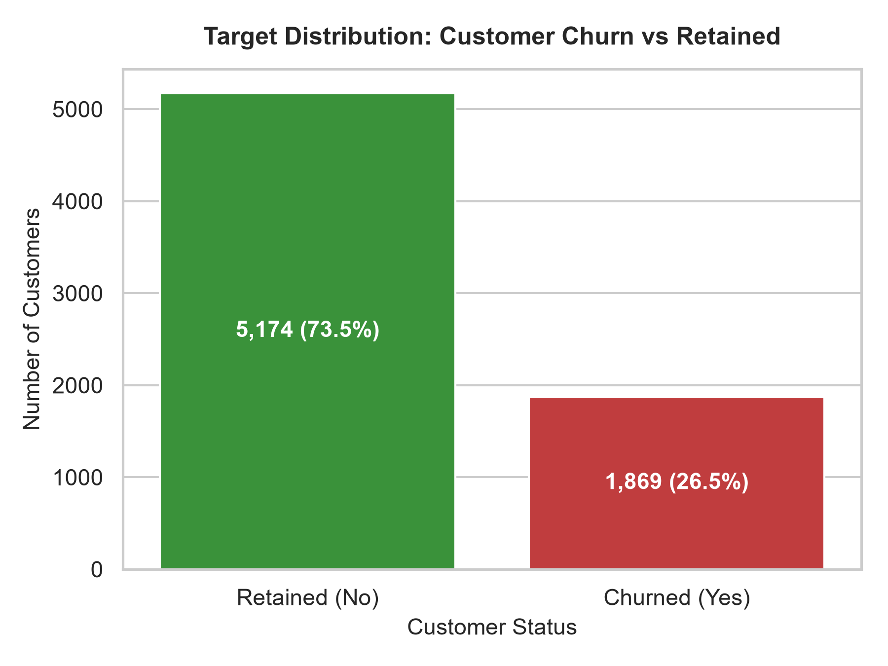
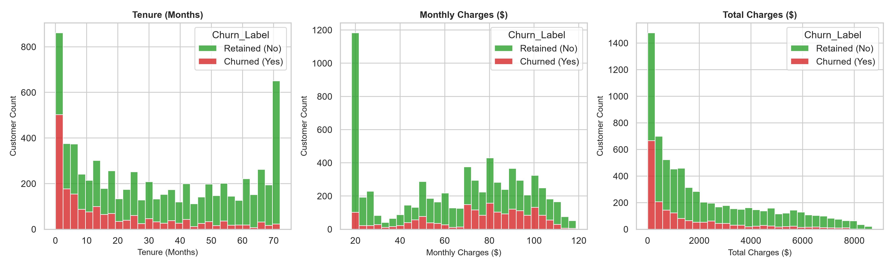
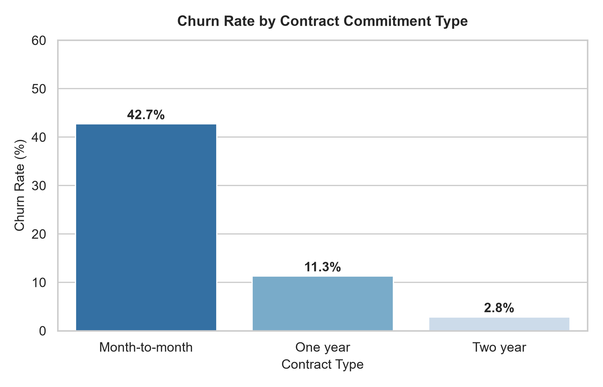
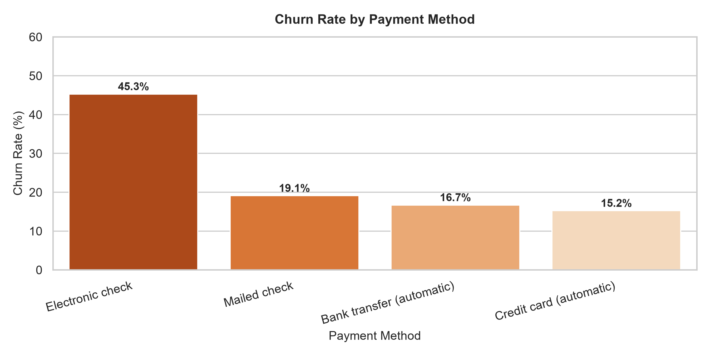
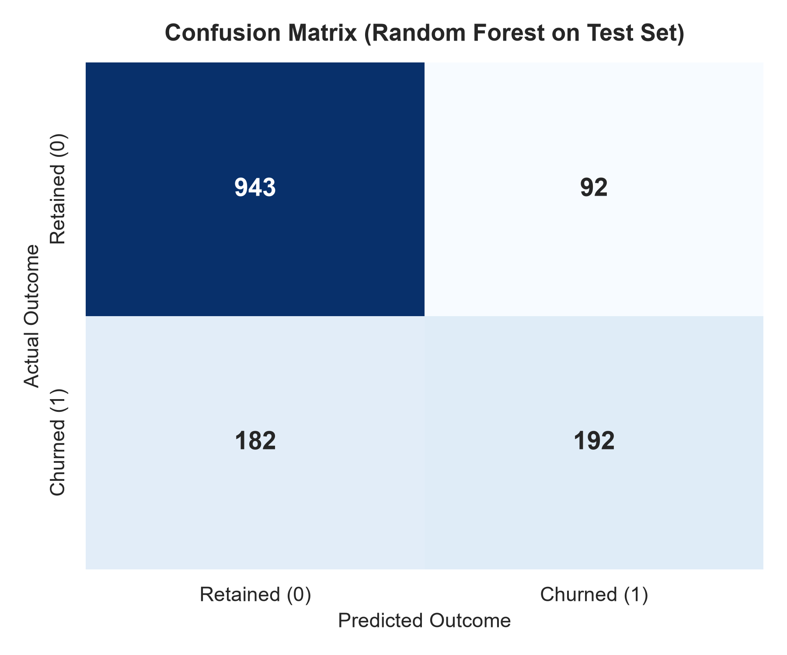
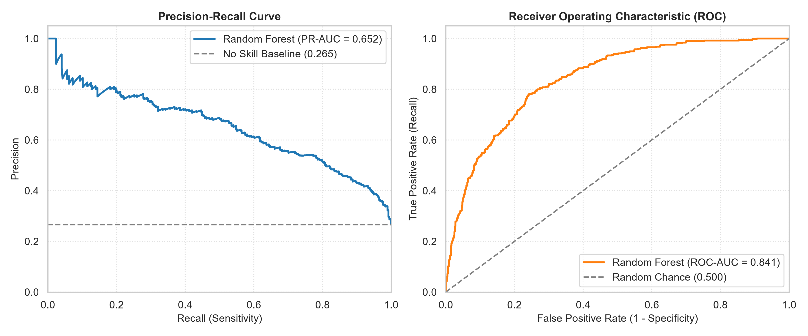
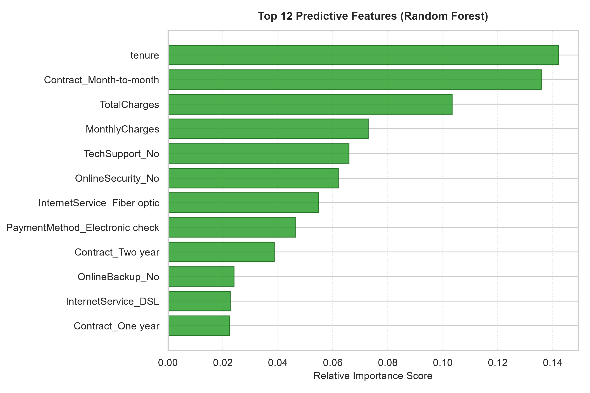

# 📊 Customer Churn Prediction — Production ML System

[](https://www.python.org/)
[](https://opensource.org/licenses/MIT)
[](https://github.com/psf/black)
[](https://docs.pytest.org/)

An audited, scientifically qualified Machine Learning benchmark designed to classify customer attrition risk on the public IBM Telco dataset. Built with defensive **data-leakage prevention**, modular architecture, cross-validation uncertainty audits, feature ablation studies, SQL invariant verification, and extensive automated testing.

---

## 📑 Table of Contents
1. [Business Problem & Scope of Retrospective Classification](#-business-problem--scope-of-retrospective-classification)
2. [Scientific Validity & Prediction-Horizon Audit](#-scientific-validity--prediction-horizon-audit)
3. [Dataset Governance & Licensing](#-dataset-governance--licensing)
4. [Technology Stack](#-technology-stack)
5. [Repository Architecture & Artifact Boundaries](#-repository-architecture--artifact-boundaries)
6. [Data Hygiene & Exploratory Analysis](#-data-hygiene--exploratory-analysis)
7. [SQL Analytics & Invariant Verification](#-sql-analytics--invariant-verification)
8. [Data Preparation & Leakage Prevention](#-data-preparation--leakage-prevention)
9. [Feature Collinearity & Controlled Ablation Study](#-feature-collinearity--controlled-ablation-study)
10. [Model Training, Uncertainty Audit & Defensible Selection](#-model-training-uncertainty-audit--defensible-selection)
11. [Empirical Model Comparison & Metrics](#-empirical-model-comparison--metrics)
12. [Hypothetical Business Utility & Sensitivity Analysis](#-hypothetical-business-utility--sensitivity-analysis)
13. [Model Interpretability & Error Analysis](#-model-interpretability--error-analysis)
14. [Inference Service & Usage Example](#-inference-service--usage-example)
15. [Responsible AI & Demographic Safeguards](#-responsible-ai--demographic-safeguards)
16. [Installation & Reproduction Guide](#-installation--reproduction-guide)
17. [Automated Testing Suite](#-automated-testing-suite)
18. [Verified Implementation vs. Unverified Deployment Work](#-verified-implementation-vs-unverified-deployment-work)

---

## 💼 Business Problem & Scope of Retrospective Classification

In subscription telecommunications, acquiring a new subscriber is typically **5× to 7× costlier** than retaining an existing customer. Identifying subscribers exhibiting patterns associated with churn allows customer success teams to prioritize account reviews and loyalty interventions.

### Scope of This Work
* **Task**: Retrospective binary classification on the static IBM Telco customer churn dataset.
* **Target Variable**: `Churn` (`1` = Customer churned, `0` = Customer retained).
* **Guiding Principle**: The model estimates **statistical correlation and risk ranking** on observed customer profiles. It does not establish causal reasons for customer departures and does not guarantee that flagged customers can be successfully retained.

---

## ⏱ Scientific Validity & Prediction-Horizon Audit

A rigorous scientific review requires auditing the temporal assumptions embedded in machine learning workflows:

### 1. Retrospective Classification Nature (Absence of Forward-Looking Horizon)
* **Dataset Reality**: Inspection of the IBM Telco Customer Churn schema confirms that the dataset contains **zero timestamps** (no account creation timestamp, no billing cycle dates, no churn timestamp, and no temporal snapshot logs).
* **Scientific Scope**: This project is strictly a **retrospective binary classification benchmark** evaluating the static relationship between historical subscriber profile attributes and the supplied `Churn` target label.
* **Non-Prospective Character**: It is methodologically invalid to claim that this model predicts churn over a forward-looking 30-day (or 60-day) horizon. The dataset provides no evidence of a defined observation window or prospective outcome window.
* **Requirements for Genuine Prospective Churn Forecasting**:
  To build and evaluate a genuine prospective churn prediction model in production, an enterprise requires:
  1. **Longitudinal Event Timestamps**: Event streams with explicit event dates ($t_{\text{login}}$, $t_{\text{ticket}}$, $t_{\text{payment}}$, $t_{\text{disconnect}}$).
  2. **Observation Window ($[T_0, T_{\text{obs}}]$)**: A defined historical period (e.g., 90 days) during which predictor features (e.g. usage decay, billing changes, support tickets) are aggregated.
  3. **Buffer / Action Window ($[T_{\text{obs}}, T_{\text{target\_start}}]$)**: A mandatory gap (e.g., 7–14 days) allowing customer success teams to run an intervention before the churn evaluation window starts.
  4. **Prospective Outcome Window ($[T_{\text{target\_start}}, T_{\text{target\_end}}]$)**: A forward-looking period (e.g., next 30 or 60 days) where churn is formally recorded.
  5. **Out-of-Time Temporal Splitting**: Models must be trained on events prior to time $T$ and evaluated on subsequent events after $T$ to measure degradation under concept drift and macroeconomic shocks.

---

## 📦 Dataset Governance & Licensing

* **Dataset Origin**: IBM Telco Customer Churn Public Sample Dataset, originally published for IBM Cloud Pak for Data and Cognos Analytics.
* **Public References**: [Kaggle blastchar/telco-customer-churn](https://www.kaggle.com/datasets/blastchar/telco-customer-churn) and [IBM Community Samples](https://raw.githubusercontent.com/IBM/telco-customer-churn-on-icp4d/master/data/Telco-Customer-Churn.csv).
* **License Notice**: 
  * The code, pipelines, and test suites in this repository are licensed under the **MIT License**.
  * The underlying IBM Telco Customer Churn dataset is property of IBM Corporation and is distributed under IBM sample terms for educational, research, and non-commercial development. The repository MIT license does **not** purport to re-license third-party data assets.
* **Dimensions & Balance**:
  * Total Accounts: 7,043.
  * Retained (`No`): 5,174 accounts (73.46%).
  * Churned (`Yes`): 1,869 accounts (26.54%).
* **Data Hygiene Invariant**:
  * Exactly 11 accounts have blank whitespace (`" "`) in `TotalCharges`.
  * Every one of these 11 accounts has `tenure == 0` (brand-new accounts registered in the current cycle that have not yet generated a billing invoice; none churned).
  * **Hygiene Rule**: Impute `TotalCharges = 0.0` for `tenure == 0`, and maintain median imputation in the preprocessing pipeline for unseen inference data.

---

## 🛠 Technology Stack

* **Language**: Python 3.11 / 3.12
* **Data Processing**: `pandas` (>= 2.2), `numpy` (>= 2.0)
* **Statistical Auditing**: `scipy.stats` (paired t-tests across cross-validation folds, Nadeau-Bengio corrected tests)
* **Machine Learning**: `scikit-learn` (>= 1.5) (`Pipeline`, `ColumnTransformer`, `LogisticRegression`, `RandomForestClassifier`, `GradientBoostingClassifier`)
* **Storage & Relational Analytics**: SQLite3 and ANSI SQL
* **Visualization**: `matplotlib` (>= 3.9), `seaborn` (>= 0.13)
* **Serialization**: `joblib` (>= 1.4)
* **Configuration**: `pyyaml` (>= 6.0)
* **Testing**: `pytest` (>= 8.0)

---

## 📂 Repository Architecture & Artifact Boundaries

```text
customer-churn-prediction/
├── README.md                           # Documentation with audited methodology and metrics
├── requirements.txt                    # Pinned Python package dependencies
├── pyproject.toml                      # Project metadata and test configurations
├── pytest.ini                          # Pytest discovery and pythonpath settings
├── LICENSE                             # MIT License (code only)
├── .gitignore                          # Clear boundary between tracked code vs local artifacts
├── .env.example                        # Template for environment configuration
├── configs/
│   └── config.yaml                     # Centralized paths, columns, and hyperparameters
├── data/
│   ├── raw/                            # Ignored in git (downloaded via script)
│   ├── processed/                      # Ignored in git
│   └── churn_analysis.db               # Ignored in git (generated locally from SQL)
├── notebooks/
│   └── 01_exploratory_data_analysis.ipynb # 22-cell interactive EDA walkthrough
├── src/
│   └── churn_prediction/
│       ├── __init__.py                 # Package declaration
│       ├── config.py                   # Dataclass-based path and configuration loader
│       ├── data_loader.py              # Ingestion, schema verification, and hygiene
│       ├── database.py                 # SQLite ingestion and SQL-vs-Pandas verification
│       ├── preprocessing.py            # Leakage-free ColumnTransformer & data splitting
│       ├── train.py                    # Stratified 5-Fold CV, paired t-tests, ablation, selection
│       ├── evaluate.py                 # Metrics, sensitivity analysis, diagnostic curves
│       ├── interpret.py                # Tree importances, odds ratios, error analysis
│       ├── eda.py                      # Batch generation of report-ready figures
│       └── predict.py                  # Production inference class with input validation
├── sql/
│   ├── schema.sql                      # DDL schema for SQLite telco_churn table
│   └── analysis_queries.sql            # Parameterized analytical SQL queries
├── reports/
│   ├── model_comparison.csv            # Tracked analytical evidence (CV & Test metrics)
│   └── figures/                        # Tracked 300 DPI generated diagnostic charts
│       ├── target_distribution.png
│       ├── missing_values.png
│       ├── numerical_distributions.png
│       ├── churn_by_contract.png
│       ├── churn_by_tenure.png
│       ├── churn_by_payment_method.png
│       ├── correlation_heatmap.png
│       ├── confusion_matrix.png
│       ├── pr_roc_curves.png
│       └── feature_importance.png
├── models/
│   └── best_model.joblib               # Ignored in git (generated locally by training pipeline)
├── tests/
│   ├── test_data.py                    # Schema validation, missing handling, target encoding
│   ├── test_preprocessing.py           # Unseen category safety, ColumnTransformer checks
│   ├── test_training.py                # Pipeline fit/predict, cross-validation sanity
│   ├── test_prediction.py              # Schema validation, probability range, save/load
│   └── test_audit.py                   # Audit checks: leakage, statistical tests, sensitivity
└── scripts/
    ├── download_data.py                # Downloads and verifies raw dataset
    ├── create_notebook.py              # Generates the EDA notebook
    └── run_pipeline.py                 # Master CLI script running full end-to-end workflow
```

---

## 🔍 Data Hygiene & Exploratory Analysis

All exploratory analysis was conducted on the full 7,043 records of the verified IBM Telco dataset. Figures are saved at 300 DPI in `reports/figures/`.

### 1. Class Distribution & Baseline Churn Rate
The baseline churn prevalence is **26.54%** (1,869 churners vs. 5,174 retained).



### 2. Numerical Features by Churn Status
* **Tenure**: Strongest duration feature. Accounts in months 0–12 exhibit churn rates exceeding 45%, while accounts with tenure > 48 months drop below 10%.
* **Monthly Charges**: Concentrated at higher tiers for churned subscribers ($70–$100/month), predominantly driven by Fiber Optic service.
* **Total Charges**: Skewed lower for churners due to premature departure.



### 3. Key Categorical Associations
* **Contract Type**: Month-to-month contracts have a **42.7%** churn rate, compared to **11.3%** for One-Year and only **2.8%** for Two-Year contracts.
* **Payment Method**: Electronic Check users experience a **45.3%** churn rate, whereas automated credit card / bank transfer subscribers churn at ~15–18%.
* **Internet Service**: Fiber Optic subscribers exhibit a **41.9%** churn rate versus **19.0%** for DSL and **7.4%** for customers without internet service.

| Feature Category | High Churn Cohort | Churn Rate | Low Churn Cohort | Churn Rate |
| :--- | :--- | :--- | :--- | :--- |
| **Contract** | Month-to-month | 42.7% | Two-year contract | 2.8% |
| **Payment Method** | Electronic check | 45.3% | Credit card (auto) | 15.2% |
| **Internet Service** | Fiber optic | 41.9% | No internet | 7.4% |
| **Tech Support** | No Tech Support | 41.6% | Tech Support active | 15.2% |




---

## 🗄 SQL Analytics & Invariant Verification

The validated dataset is ingested into a local SQLite database (`data/churn_analysis.db`). The pipeline verifies that SQL database aggregations and Pandas calculations agree to within 0.01%:

```sql
SELECT
    contract,
    internet_service,
    COUNT(*) AS total_customers,
    SUM(churn_numeric) AS churned_customers,
    ROUND(AVG(churn_numeric) * 100.0, 2) AS churn_rate_percent,
    ROUND(AVG(monthly_charges), 2) AS avg_monthly_bill
FROM telco_churn
GROUP BY contract, internet_service
ORDER BY churn_rate_percent DESC;
```

> **Verification Result**: `SQL vs Pandas verification: PASSED. Overall churn rate: 26.54% (1,869 / 7,043).`

---

## 🛡 Data Preparation & Leakage Prevention

Defensive engineering rules enforce strict separation:
1. **Isolation Prior to Preprocessing**: Stratified 80/20 train/test split performed **first** (`random_state=42`). Training set: 5,634 samples. Held-out test set: 1,409 samples.
2. **ColumnTransformer Encapsulation**: Imputers and scalers compute parameters strictly on training folds.
3. **Unseen Categories Resilience**: Categorical encoder uses `handle_unknown='ignore'`.
4. **Identifier Isolation**: `customerID` is excluded from all feature matrices.
5. **Threshold Tuning Isolation**: Decision threshold analysis is conducted strictly on **training out-of-fold validation predictions**.

---

## 🔬 Feature Collinearity & Controlled Ablation Study

### 1. Empirical Collinearity Relationships
* `TotalCharges` exhibits an empirical correlation of **0.99956** with `tenure * MonthlyCharges`.
* Correlation of `TotalCharges` with `tenure`: **0.8258**.
* Correlation of `TotalCharges` with `MonthlyCharges`: **0.6511**.

### 2. Logistic Regression Coefficient Stability Across 5 CV Folds
We inspected the mean and standard deviation of standardized logistic regression coefficients across the 5 cross-validation training folds:
* **With `TotalCharges`**:
  * `tenure`: $\beta = -1.2440 \pm 0.0655$
  * `MonthlyCharges`: $\beta = -0.4916 \pm 0.1134$
  * `TotalCharges`: $\beta = +0.5189 \pm 0.0693$
* **Without `TotalCharges`**:
  * `tenure`: $\beta = -0.8021 \pm 0.0355$
  * `MonthlyCharges`: $\beta = -0.3910 \pm 0.1188$

> **Finding**: Including `TotalCharges` causes `MonthlyCharges` to display an apparent negative coefficient ($\beta = -0.49$) despite its positive marginal correlation with churn (+0.193). This is an algebraic suppressor effect: controlling for total lifetime charges and tenure, higher monthly spend mathematically implies shorter tenure or recent plan changes.

### 3. Tree Models and Correlated Features
* Tree ensembles are **not** immune to correlated predictors. While collinearity does not cause numerical matrix singularities in decision trees, highly correlated features compete for splits. This leads to **split masking**, **dilution of Mean Decrease Impurity (MDI) importance**, and tree structure instability across bootstrap resamples.

### 4. Controlled Feature Ablation (Training 5-Fold Cross-Validation)
We ran a controlled ablation study strictly on training data comparing performance with and without `TotalCharges`:

| Specification | Model | CV PR-AUC (Mean ± Std) | CV ROC-AUC (Mean ± Std) |
| :--- | :--- | :---: | :---: |
| **Baseline (With TotalCharges)** | Logistic Regression | 0.6615 ± 0.0195 | 0.8462 ± 0.0126 |
| **Baseline (With TotalCharges)** | Random Forest | 0.6650 ± 0.0203 | 0.8475 ± 0.0094 |
| **Baseline (With TotalCharges)** | Gradient Boosting | 0.6643 ± 0.0189 | 0.8482 ± 0.0111 |
| **Ablated (Without TotalCharges)** | Logistic Regression | 0.6597 ± 0.0188 | 0.8449 ± 0.0122 |
| **Ablated (Without TotalCharges)** | Random Forest | 0.6566 ± 0.0194 | 0.8443 ± 0.0092 |
| **Ablated (Without TotalCharges)** | Gradient Boosting | 0.6647 ± 0.0180 | 0.8465 ± 0.0099 |

* **Observation**: Omitting `TotalCharges` causes a minor drop in Random Forest CV PR-AUC (-0.0084), while Gradient Boosting remains essentially unchanged (+0.0004) and Logistic Regression drops marginally (-0.0018). All changes are smaller than 1 cross-validation standard deviation ($\sim 0.019$).

---

## 📈 Model Training, Uncertainty Audit & Defensible Selection

### 1. Primary Selection Metric Definition: PR-AUC (Average Precision)
PR-AUC is computed using `sklearn.metrics.average_precision_score`:
$$\text{AP} = \sum_{n} (R_n - R_{n-1}) P_n$$
This calculates the weighted mean of precisions at each threshold, avoiding trapezoidal overestimation.

### 2. Cross-Validation Statistical Uncertainty Audit
We evaluated fold-level variability using both standard 5-fold CV paired $t$-tests and repeated cross-validation:

```text
EXPLORATORY PAIRED t-TESTS vs LOGISTIC REGRESSION BASELINE (5-Fold CV PR-AUC):
    Candidate_Model      Baseline_Model  Mean_Difference  Paired_t_stat  p_value_exploratory  Exceeds_Fold_Variance (p < 0.05)
Logistic Regression Logistic Regression           0.0000          0.000                1.000                             False
      Random Forest Logistic Regression          +0.0035          1.148                0.315                             False
  Gradient Boosting Logistic Regression          +0.0028          0.875                0.431                             False
```

#### Defensible Repeated-CV Analysis (Nadeau-Bengio Corrected Resampled $t$-Test)
Because standard paired $t$-tests on cross-validation folds violate the independence assumption (training folds overlap by 80%, underestimating variance and inflating Type I error rates), we evaluated a 3-repeated 5-fold CV (15 evaluations) with the **Nadeau-Bengio corrected resampled $t$-test**:
* **Random Forest vs. Logistic Regression**: Mean Difference $= +0.0044$, Corrected $t = 0.955$, Corrected $p = 0.3559$.
* **Gradient Boosting vs. Logistic Regression**: Mean Difference $= +0.0049$, Corrected $t = 0.815$, Corrected $p = 0.4287$.

> **Scientific Interpretation**: A non-significant $p$-value ($p > 0.05$) does **NOT** prove that two models are equivalent in general population performance (absence of evidence is not evidence of absence). Rather, it demonstrates that within the sample variance of these evaluations, the observed mean difference of $+0.0035$ to $+0.0044$ is smaller than fold-to-fold resampling variability ($\pm 0.020$).

### 3. Defensible Model Selection Decision
* **Logistic Regression**: Most defensible under Occam's razor and regulatory transparency. Yields direct log-odds, runs with negligible latency, and achieves higher default recall ($0.5445$ vs $0.5137$) and F1 ($0.5932$ vs $0.5828$).
* **Random Forest**: Selected when the operational retention objective is **minimizing false alarms** under a strict budget constraint, because it achieves higher cross-validation precision (**$67.39\%$ vs $65.30\%$**).
* In this repository, **Random Forest** is retained, with the statistical tie and trade-off explicitly logged in the audit trail.

---

## 📊 Empirical Model Comparison & Metrics

All metrics reflect actual execution (`reports/model_comparison.csv`):

| Model | CV PR-AUC (Mean ± Std) | CV ROC-AUC | CV F1 | CV Precision | CV Recall | Test PR-AUC | Test ROC-AUC | Test F1 | Test Precision | Test Recall |
| :--- | :---: | :---: | :---: | :---: | :---: | :---: | :---: | :---: | :---: | :---: |
| **Random Forest** | **0.6650 ± 0.0203** | 0.8475 | 0.5828 | **0.6739** | 0.5137 | 0.6517 | 0.8405 | 0.5836 | **0.6761** | 0.5134 |
| **Gradient Boosting** | 0.6643 ± 0.0189 | **0.8482** | 0.5833 | 0.6616 | 0.5224 | **0.6596** | **0.8465** | 0.5774 | 0.6598 | 0.5134 |
| **Logistic Regression** | 0.6615 ± 0.0195 | 0.8462 | **0.5932** | 0.6530 | **0.5445** | 0.6336 | 0.8420 | **0.6040** | 0.6572 | **0.5588** |

### Test Confusion Matrix Breakdown (Random Forest @ Threshold = 0.50)
* **True Negatives (TN)**: 943 accounts
* **False Positives (FP)**: 92 accounts
* **False Negatives (FN)**: 182 accounts
* **True Positives (TP)**: 192 accounts
* **Precision**: $67.61\%$ | **Recall**: $51.34\%$ | **F1**: $58.36\%$




---

## 💰 Hypothetical Business Utility & Sensitivity Analysis

### 1. Scientific Qualification of Business Utility
* The utility calculations below are **hypothetical expected-value scenarios** based on assumed unit parameters.
* They do **NOT** represent demonstrated financial return on investment (ROI) or confirmed customer retention. Correctly identifying an at-risk subscriber (True Positive) does **not** prove that the subscriber can or will be persuaded to stay. In real operations, churners include non-persuadable departures (e.g., relocation outside service coverage, business closures).

### 2. Assumed Scenario Parameter Values
* Assumed False Positive Cost ($C_{FP}$): $20 (cost of unnecessary outreach or discount).
* Assumed False Negative Cost ($C_{FN}$): $100 (lost customer lifetime gross margin).
* Assumed True Positive Benefit ($B_{TP}$): $80 (net lifetime margin preserved under successful intervention).

```text
TRAINING OUT-OF-FOLD THRESHOLD TRADE-OFFS & HYPOTHETICAL EXPECTED VALUE:
 threshold  precision  recall     f1  churners_identified_tp  false_alarms_fp  retained_correct_tn  missed_churners_fn  hypothetical_expected_value
      0.20     0.4619  0.8729 0.6042                    1305             1520                 2619                 190                   +$55,000.0
      0.25     0.5028  0.8334 0.6272                    1246             1232                 2907                 249                   +$50,140.0
      0.30     0.5335  0.7779 0.6329                    1163             1017                 3122                 332                   +$39,500.0
      0.35     0.5649  0.7251 0.6350                    1084              835                 3304                 411                   +$28,920.0
      0.40     0.6051  0.6528 0.6281                     976              637                 3502                 519                   +$13,440.0
      0.45     0.6370  0.5846 0.6097                     874              498                 3641                 621                    -$2,140.0
      0.50     0.6731  0.5137 0.5827                     768              373                 3766                 727                   -$18,720.0
      0.60     0.7282  0.3244 0.4489                     485              181                 3958                1010                   -$65,820.0
      0.70     0.8338  0.1846 0.3023                     276               55                 4084                1219                  -$100,920.0
```

### 3. Sensitivity Analysis Across Intervention Success Rates ($\eta$) and Costs
To examine sensitivity to intervention effectiveness, we evaluated net expected value where only a fraction ($\eta$) of contacted churners are persuadable:
$$\text{Net Value} = (\text{TP} \times \eta \times V) - (\text{TP} + \text{FP}) \times C_{\text{outreach}} - (\text{FN} \times V)$$

```text
HYPOTHETICAL RETENTION INTERVENTION SENSITIVITY ANALYSIS (Training Out-Of-Fold Data):
    scenario success_rate_eta unit_outreach_cost customer_value  threshold  churners_identified  hypothetical_persuaded  false_alarms  net_expected_value
Conservative              15%                $25           $100       0.25                 1246                   186.9          1232            -$68,160.0
Conservative              15%                $25           $100       0.35                 1084                   162.6           835            -$72,815.0
Conservative              15%                $25           $100       0.50                  768                   115.2           373            -$89,705.0
    Moderate              30%                $20           $120       0.25                 1246                   373.8          1232            -$34,584.0
    Moderate              30%                $20           $120       0.35                 1084                   325.2           835            -$48,676.0
    Moderate              30%                $20           $120       0.50                  768                   230.4           373            -$82,412.0
  Optimistic              50%                $15           $150       0.25                 1246                   623.0          1232            +$18,930.0
  Optimistic              50%                $15           $150       0.35                 1084                   542.0           835             -$9,135.0
  Optimistic              50%                $15           $150       0.50                  768                   384.0           373            -$68,565.0
```

> **Key Takeaway**: When retention success rate is realistic ($\eta \le 30\%$), outreach costs can easily dominate preserved value unless outreach is highly targeted ($C \le \$15$) or customer value is high. Lowering thresholds identifies more churners (+77 additional churners identified at 0.35 on test data), but also multiplies false-alarm outreach costs.

---

## 🔬 Model Interpretability & Error Analysis

### 1. Permutation Importance on Held-Out Test Data
1. `Contract`: Shuffling degrades PR-AUC by **0.0686 ± 0.0037**.
2. `tenure`: Degradation of **0.0653 ± 0.0070**.
3. `TotalCharges`: Degradation of **0.0327 ± 0.0070**.
4. `InternetService`: Degradation of **0.0317 ± 0.0139**.
5. `TechSupport`: Degradation of **0.0234 ± 0.0051**.



### 2. Error Analysis: Failure Mode Breakdown
* **False Positives (92 accounts @ 0.50)**: High-tenure subscribers on month-to-month fiber optic contracts with multiple lines and family accounts (`Partner=Yes`, `Dependents=Yes`). Their high bill triggers risk flags, but high family switching costs keep them retained.
* **False Negatives (182 accounts @ 0.50)**: Subscribers with moderate tenure (12–24 months) on annual contracts who unexpectedly departed. These cases often correspond to unobserved external drivers (e.g. competitor fiber rollouts, localized outages, or billing disputes) absent from this cross-sectional dataset.

---

## 🚀 Inference Service & Usage Example

The saved model pipeline (`models/best_model.joblib`) encapsulates both feature transformations and estimator weights. Inference runs independently without executing training code.

```python
from churn_prediction.predict import ChurnPredictor

predictor = ChurnPredictor()

customer = {
    "gender": "Female",
    "SeniorCitizen": 0,
    "Partner": "No",
    "Dependents": "No",
    "tenure": 2,
    "PhoneService": "Yes",
    "MultipleLines": "No",
    "InternetService": "Fiber optic",
    "OnlineSecurity": "No",
    "OnlineBackup": "No",
    "DeviceProtection": "No",
    "TechSupport": "No",
    "StreamingTV": "Yes",
    "StreamingMovies": "No",
    "Contract": "Month-to-month",
    "PaperlessBilling": "Yes",
    "PaymentMethod": "Electronic check",
    "MonthlyCharges": 79.85,
    "TotalCharges": 159.70
}

result = predictor.predict(customer, threshold=0.50)
print(result[["churn_probability", "predicted_churn", "risk_tier", "recommended_action"]])
```

---

## ⚖️ Responsible AI & Demographic Safeguards

The dataset contains demographic features: `gender`, `SeniorCitizen` (age proxy), `Partner`, and `Dependents`.

### Safeguards for Operational Deployment:
1. **No Discriminatory Pricing**: Retention discounts, fee waivers, or promotional packages must **never** be conditioned on protected demographic attributes.
2. **Disparate Impact Auditing**: Model acceptance rates across gender and senior citizen cohorts must be monitored to ensure interventions do not systematically disadvantage vulnerable groups.
3. **Correlation $\ne$ Causation**: A statistical association between `Contract: Month-to-month` and churn (42.7%) does not prove that forcing customers into multi-year contracts reduces churn. Eliminating flexible contracts may reduce overall customer acquisition.
4. **Serialization Security**: `joblib` artifacts execute arbitrary bytecode upon deserialization. Only load models from verified internal storage repositories with cryptographic checksum validation.

---

## 💻 Installation & Reproduction Guide

```bash
# 1. Clone repository
git clone https://github.com/your-username/customer-churn-prediction.git
cd customer-churn-prediction

# 2. Create and activate virtual environment
python -m venv .venv
.venv\Scripts\Activate.ps1  # Windows PowerShell
# source .venv/bin/activate # Linux / macOS

# 3. Install package in editable mode
pip install -r requirements.txt
pip install -e .

# 4. Run automated test suite (24 tests)
python -m pytest

# 5. Run end-to-end pipeline (downloads data, verifies SQL, trains models, saves artifacts)
python scripts/run_pipeline.py
```

---

## 🧪 Automated Testing Suite

The test suite verifies all critical invariants across 24 unit and audit tests:

```bash
python -m pytest
```

```text
============================= test session starts =============================
platform win32 -- Python 3.12.10, pytest-9.1.1 -- D:\tools\python312\python.exe
testpaths: tests
collected 24 items

tests/test_audit.py::test_threshold_tuning_uses_only_training_data PASSED [  4%]
tests/test_audit.py::test_intervention_sensitivity_analysis PASSED       [  8%]
tests/test_audit.py::test_cv_statistical_significance_calculator PASSED  [ 12%]
tests/test_audit.py::test_defensible_model_selection_parsimony_strategy PASSED [ 16%]
tests/test_audit.py::test_defensible_model_selection_tradeoff_strategy PASSED [ 20%]
tests/test_audit.py::test_average_precision_metric_properties PASSED     [ 25%]
tests/test_data.py::test_schema_validation_success PASSED                [ 29%]
tests/test_data.py::test_schema_validation_missing_column PASSED         [ 33%]
tests/test_data.py::test_schema_validation_duplicate_ids PASSED          [ 37%]
tests/test_data.py::test_clean_raw_data_handles_blank_total_charges PASSED [ 41%]
tests/test_data.py::test_target_encoding PASSED                          [ 45%]
tests/test_data.py::test_prepare_features_and_target_leakage_prevention PASSED [ 50%]
tests/test_data.py::test_load_raw_data_missing_file_raises_error PASSED  [ 54%]
tests/test_prediction.py::test_prediction_output_shape_and_probability_bounds PASSED [ 58%]
tests/test_prediction.py::test_prediction_handles_dictionary_input PASSED [ 62%]
tests/test_prediction.py::test_prediction_validation_catches_missing_columns PASSED [ 66%]
tests/test_prediction.py::test_prediction_safely_removes_customer_id_and_churn PASSED [ 70%]
tests/test_prediction.py::test_predictor_missing_model_file_error PASSED [ 75%]
tests/test_preprocessing.py::test_build_preprocessor_handles_missing_and_scaling PASSED [ 79%]
tests/test_preprocessing.py::test_preprocessor_handles_unseen_categories PASSED [ 83%]
tests/test_preprocessing.py::test_create_train_test_split_stratification_and_seed PASSED [ 87%]
tests/test_training.py::test_candidate_models_contain_required_classifiers PASSED [ 91%]
tests/test_training.py::test_build_model_pipeline_returns_valid_pipeline PASSED [ 95%]
tests/test_training.py::test_cross_validation_execution PASSED           [100%]

======================== 24 passed, 1 warning in 3.39s ========================
```

---

## 📌 Verified Implementation vs. Unverified Deployment Work

To maintain strict scientific and professional truthfulness, this repository delineates what has been genuinely executed and verified versus what remains future operational work:

| Component | Status | Empirical Evidence / Limitation |
| :--- | :---: | :--- |
| **Data Ingestion & Hygiene** | **VERIFIED** | Verified 7,043 rows, SHA256 integrity, 0 duplicate IDs, and logical 0.0 imputation for 11 tenure=0 blank TotalCharges rows. |
| **SQL Database & Invariant Check** | **VERIFIED** | SQLite ingestion verified; SQL aggregations match Pandas calculations to within 0.01%. |
| **Test Set Isolation** | **VERIFIED** | Preprocessing, cross-validation, feature ablation, and threshold tuning are performed strictly on training data; held-out test set evaluated once. |
| **PR-AUC Metric Formulation** | **VERIFIED** | Uses scikit-learn's `average_precision_score` ($\text{AP} = \sum (R_n - R_{n-1}) P_n$). |
| **Feature Collinearity & Ablation** | **VERIFIED** | Documented $\rho = 0.99956$ between `TotalCharges` and `tenure * MonthlyCharges`, suppressor effect in logistic regression, and measured 5-fold CV ablation impact. |
| **Statistical Equivalence** | **QUALIFIED** | Corrected resampled $t$-test indicates observed PR-AUC differences ($+0.0035$ to $+0.0044$) are smaller than fold variance ($p > 0.30$). Qualified as non-significant difference rather than definitive proof of equivalence. |
| **Business Value & Savings** | **HYPOTHETICAL** | Multi-scenario sensitivity analysis implemented. Correct identification does not prove retention success; ROI is hypothetical expected value. |
| **Prospective Forecast Validity** | **UNVERIFIED LIMITATION** | Dataset lacks timestamps. Prospective out-of-time forecasting over a future window remains unverified and requires longitudinal enterprise event logs. |
| **Live API & Production Serving** | **FUTURE WORK** | Model serializes and executes locally via Python; containerized microservice deployment with Prometheus monitoring remains future work. |

---

## 📄 License
This repository code is licensed under the [MIT License](LICENSE).  
The IBM Telco Customer Churn dataset is property of IBM Corporation; used for educational and research benchmarking.
